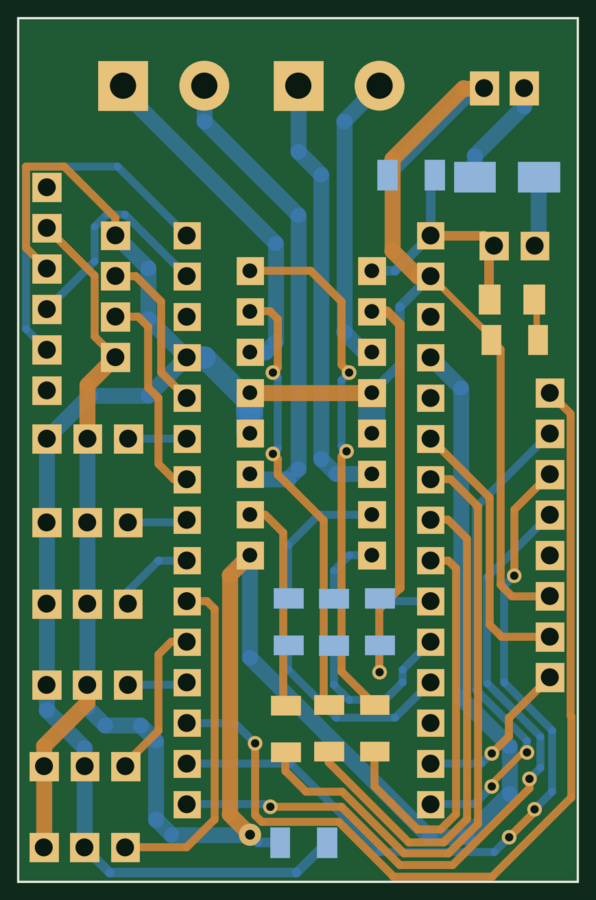
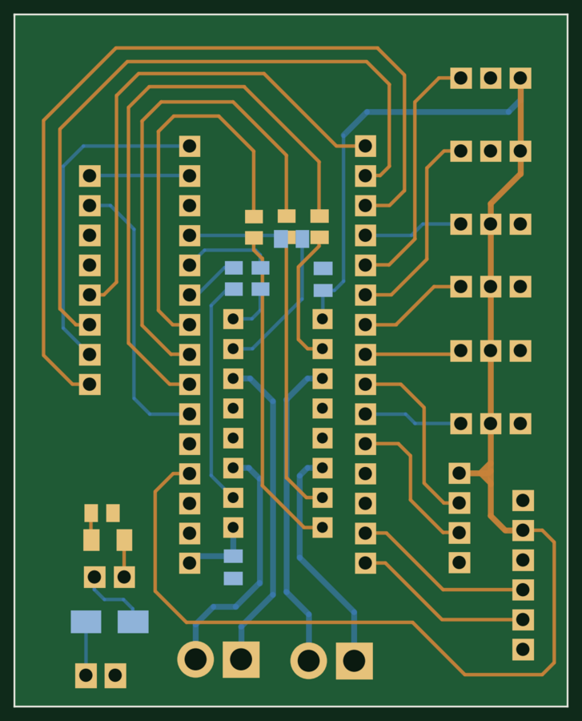
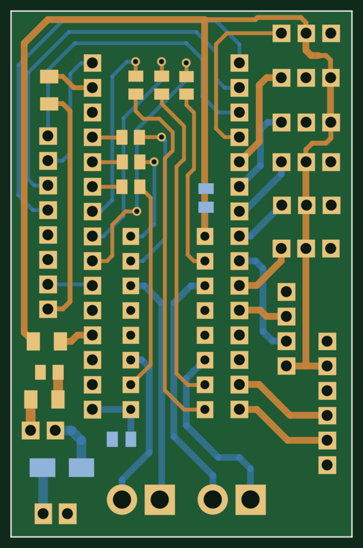

# Mechatronics Kit

Hardware and firmware for an educational robotics kit. A handheld remote controls a hexagonal robot board over **Bluetooth (HC-05)** or **Wi-Fi (ESP-01)**. The repo includes the kit's KiCad designs (a robot controller and two revisions of a motor-driver board), the wireless link firmware, and the sensor tests used for quality checks before shipping.



*Robot controller board — 2-layer, 35 × 54 mm (rendered from the KiCad layout)*

---

## System overview

```
 Remote controller                               Hex robot board
 ┌───────────────────────┐   Bluetooth (HC-05)   ┌───────────────────────┐
 │ Arduino Nano          │ ────────────────────► │ Arduino Nano          │
 │ Joystick (A0/A1)      │         or            │ Motor driver (L293D)  │
 │ HC-05 / ESP-01        │ ────────────────────► │ HC-05 / ESP-01        │
 └───────────────────────┘   Wi-Fi UDP (ESP-01)  │ Sensors               │
                                                 └───────────────────────┘
```

The joystick position is encoded as simple one-byte direction codes and sent over whichever radio is fitted.

## Hardware

**Robot controller** (`hardware/otto-controller/`)
- Built around an Arduino Nano Every, with an L293D dual H-bridge for two DC motors on screw terminals.
- Four servo headers, plus headers for an ultrasonic sensor, two IR sensors, a Bluetooth module and an RFID reader.
- B120 Schottky diode for reverse-polarity protection on the battery input.
- 2-layer, 35 × 54 mm.

**L293D motor-driver breakout** (`hardware/l293d-motor-driver/`)
- An Arduino Nano socket with an L293D driving four outputs (two DC motors), six 3-pin servo/sensor headers, a protected power input and a status LED.
- **Rev 1.0** (May 2022): 47 × 59 mm, Gerbers included.
- **Rev 2:** shrunk to 35 × 54 mm, with fuses added for protection.

| Rev 1.0 | Rev 2 |
|---|---|
|  |  |

## Firmware

**Bluetooth link** (HC-05, master/slave pairing)

| Sketch | Board | Purpose |
|---|---|---|
| `remote-controller/bt_master_at_setup` | Remote | Serial passthrough to configure the HC-05 as master (`AT+ROLE=1`, `AT+CMODE=1`) and read its address |
| `hex-board/bt_slave_at_setup` | Robot | Configures the robot's HC-05 as a slave bound to the master's address |
| `remote-controller/bt_joystick_master` | Remote | Reads the joystick and sends direction codes over Bluetooth |
| `hex-board/bt_slave_receiver` | Robot | Receives direction codes |

**Wi-Fi link** (ESP-01, UDP)

| Sketch | Board | Purpose |
|---|---|---|
| `hex-board/esp01_udp_access_point` | Robot's ESP-01 | Creates a soft access point and listens on UDP port 2000 |
| `remote-controller/esp01_udp_client` | Remote's ESP-01 | Joins the robot's access point and forwards serial bytes as UDP packets |
| `remote-controller/nano_joystick_to_esp01` | Remote's Nano | Reads the joystick and sends commands to the ESP-01 over serial |
| `hex-board/nano_esp01_receiver` | Robot's Nano | Reads commands from the ESP-01 over serial |

Using UDP on a private access point keeps latency low and avoids needing a router. Set your own SSID and password in place of the `YOUR_AP_...` placeholders.

**Sensor tests** (`firmware/sensor-tests/`)
- Bring-up and QC sketches for the HC-SR04 ultrasonic, PIR, IR obstacle and flame sensors, and a button input.
- Several are adapted from standard Arduino and community examples, and keep their original headers.

## Setup procedures

**Pairing the HC-05 modules**
1. Bridge VCC to EN on the remote's HC-05 so it boots into AT mode.
2. Upload `bt_master_at_setup` and send the AT commands listed in the sketch. Note the module's address.
3. Remove the bridge and upload `bt_joystick_master`.
4. Repeat on the robot with `bt_slave_at_setup`, entering the master's address, then upload `bt_slave_receiver`.

**Flashing the ESP-01**
1. Connect the ESP-01 to a USB-TTL adapter.
2. Short GPIO0 to GND to enter flash mode.
3. Start the upload from the Arduino IDE.
4. Press reset as the upload begins.

## Repository structure

```
Mechatronics-Kit/
├── hardware/
│   ├── otto-controller/        Robot controller board (KiCad)
│   └── l293d-motor-driver/     Motor driver, rev 1.0 (+ Gerbers) and rev 2
├── firmware/
│   ├── remote-controller/      Joystick remote: Bluetooth master, ESP-01 client
│   ├── hex-board/              Robot: Bluetooth slave, ESP-01 access point
│   └── sensor-tests/           Sensor bring-up and QC sketches
└── docs/images/                Board renders
```

Open any `.kicad_pro` file in **KiCad 6** or newer. Sketches open in the Arduino IDE; the ESP-01 sketches need the ESP8266 board package.

## Tools

KiCad 6 · Arduino IDE · Arduino Nano / Nano Every · ESP8266 (ESP-01) · HC-05 Bluetooth · L293D

## License

No license is granted. This repository is shared as a portfolio of my work; all rights reserved.

---

**Smit Vaghela** — Embedded Software / Firmware Engineer · [GitHub](https://github.com/smit2400)
